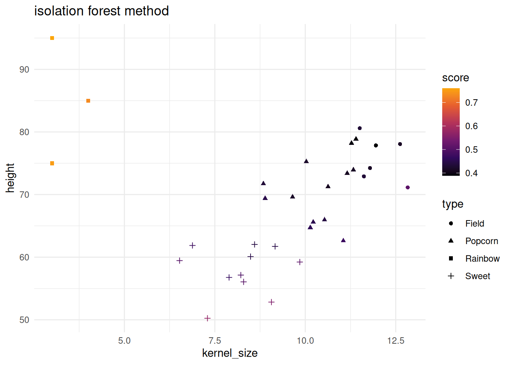
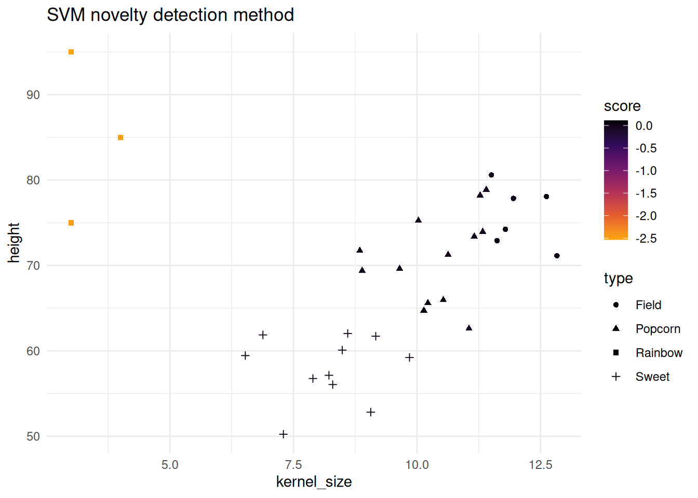
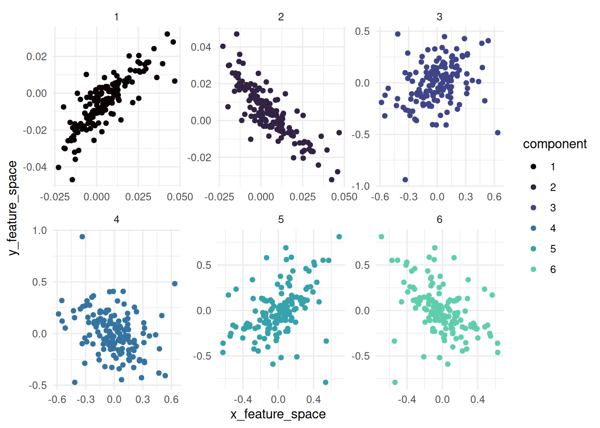

# glass-gem

``` r

options(repos = c(CRAN = "https://cloud.r-project.org"))
install.packages("devtools")
install.packages("applicable")
install.packages("isotree")

library(applicable)
library(ggplot2)
library(kernlab)
library(maize)
library(dplyr)

# heldout novel/anomaly type 
corn_glass_gem <- data.frame(
  height      = c(85, 75, 95),
  kernel_size = c(4., 3., 3),
  type        = c("Rainbow")
)

set.seed(31415)
corn_train <- corn_data |> dplyr::sample_frac(.90)
corn_test  <- corn_data |> dplyr::anti_join(corn_train)

# add the novel type to the test data
corn_test <- corn_test |> dplyr::bind_rows(corn_glass_gem)
```

## {maize} for novelty detection

An extension of {applicable}:  
*“There are times when a model’s prediction should be taken with some
skepticism. For example, if a new data point is substantially different
from the training set, its predicted value may be suspect. In chemistry,
it is not uncommon to create an “applicability domain” model that
measures the amount of potential extrapolation new samples have from the
training set. applicable contains different methods to measure how much
a new data point is an extrapolation from the original data (if at
all).”*

Within {applicable}, there lies an isolation forest technique for
anomaly detection. SVMs are also known for novelty detection and outlier
selection.

Below both the isolation forest and one-SVC methods are shown. Note that
the corn testing data has a new type added to it. “Rainbow” corn has
been added and differs from the other three corn types. Below will
showcase how both methods pick up on the new type.

##### isolation forest score method

The isolation forest method is based on isotree and is the base code
used for the SVM method shown in the next section.

``` r

if_mod <- apd_isolation(corn_train |> dplyr::select(-type), ntrees = 10, nthreads = 1)
if_mod
#> Applicability domain via isolation forests
#> 
#> Isolation Forest model
#> Consisting of 10 trees
#> Numeric columns: 2

isolation_scores <- score(if_mod, corn_test |> dplyr::select(-type))
head(isolation_scores)
#> # A tibble: 6 × 2
#>   score score_pctl
#>   <dbl>      <dbl>
#> 1 0.502       82.6
#> 2 0.572       94.7
#> 3 0.447       55.0
#> 4 0.475       72.4
#> 5 0.466       68.2
#> 6 0.504       83.3
```

``` r

corn_test |>
  bind_cols(isolation_scores) |> 
  ggplot() + 
  geom_point(aes(x = kernel_size, y = height, color = score, shape = type)) +
  theme_minimal() +
  scale_color_viridis_c(option = "B", end = .8) +
  labs(title = "isolation forest method")
```



##### SVM novelty detection score method

This implementation is based on one-class-svc (novelty) detection method
found in kernlab.

``` r


svm_mod <- apd_svm_novel_detection(corn_train |> dplyr::select(-type), kernel = "rbfdot", nu = .1)
svm_mod
#> Applicability domain via SVMs
#> 
#> Support Vector Machine object of class "ksvm" 
#> 
#> SV type: one-svc  (novelty detection) 
#>  parameter : nu = 0.1 
#> 
#> Gaussian Radial Basis kernel function. 
#>  Hyperparameter : sigma =  1.63116623323711 
#> 
#> Number of Support Vectors : 49 
#> 
#> Objective Function Value : 32.7176 
#> Training error : 0.12963

novel_scores <- score(svm_mod, corn_test |> dplyr::select(-type))
head(novel_scores)
#> # A tibble: 6 × 2
#>      score score_pctl
#>      <dbl>      <dbl>
#> 1  0.0849       84.1 
#> 2  0.0471       68.8 
#> 3 -0.00638       5.81
#> 4  0.0378       64.1 
#> 5  0.00298      28.8 
#> 6  0.0271       57.4
```

``` r

corn_test |>
  bind_cols(novel_scores) |> 
  ggplot() + 
  geom_point(aes(x = kernel_size, y = height, color = score, shape = type)) +
  theme_minimal() +
  scale_color_viridis_c(option = "B", end = .8, direction = -1) +
  labs(title = "SVM novelty detection method")
```



## {maize} for kernel canonical correlation analysis

Based on the tidymodels’ {corrr} package: *“corrr is a package for
exploring correlations in R. It focuses on creating and working with
data frames of correlations (instead of matrices) that can be easily
explored via corrr functions or by leveraging tools like those in the
tidyverse.”*

{maize} aims to do a similar approach but for kernlab’s kcca function.
This method is an non-linear extension of canonical correlation analysis
and differs from CCA. Instead of finding linear combinations of
variables that maximize correlation between two sets, KCCA maps data to
a high-dimensional feature space using a kernel function and then
applies CCA in that space.

##### kernel canonical correlation analysis

Kernel Canonical Correlation Analysis (KCCA) is a non-linear extension
of CCA and will handle comparisons between two variables or datasets,
(x, y).

The analysis workflow is shown below:

``` r

corn_set_one <- corn_data |> dplyr::sample_frac(.50)
corn_set_two <- corn_data |> dplyr::anti_join(corn_set_one)
#> Joining with `by = join_by(height, kernel_size, type)`

maize_kcca <- 
  kcca_correlate(x = corn_set_one, 
                 y = corn_set_two, 
                 num_comp = 6)

maize_kcca |>
  str()
#> kcor_df [900 × 5] (S3: kcor_df/tbl_df/tbl/data.frame)
#>  $ component            : num [1:900] 1 1 1 1 1 1 1 1 1 1 ...
#>  $ canonical_correlation: num [1:900] -0.992 -0.992 -0.992 -0.992 -0.992 ...
#>  $ sample               : int [1:900] 1 2 3 4 5 6 7 8 9 10 ...
#>  $ x_feature_space      : num [1:900] 0.0057 0.01295 -0.00951 0.00222 -0.00508 ...
#>  $ y_feature_space      : num [1:900] -0.003173 -0.000951 -0.016546 -0.008046 -0.016327 ...
```

kernel canonical correlations:

``` r

maize_kcca |>
  dplyr::group_by(component) |>
  dplyr::slice(1) |>
  dplyr::select(component, canonical_correlation)
#> # A tibble: 6 × 2
#> # Groups:   component [6]
#>   component canonical_correlation
#>       <dbl>                 <dbl>
#> 1         1                -0.992
#> 2         2                 0.992
#> 3         3                -0.828
#> 4         4                 0.828
#> 5         5                -0.807
#> 6         6                 0.807
```

visualizing the feature space of the KCCA feature space:

``` r

maize_kcca |> autoplot()
```


