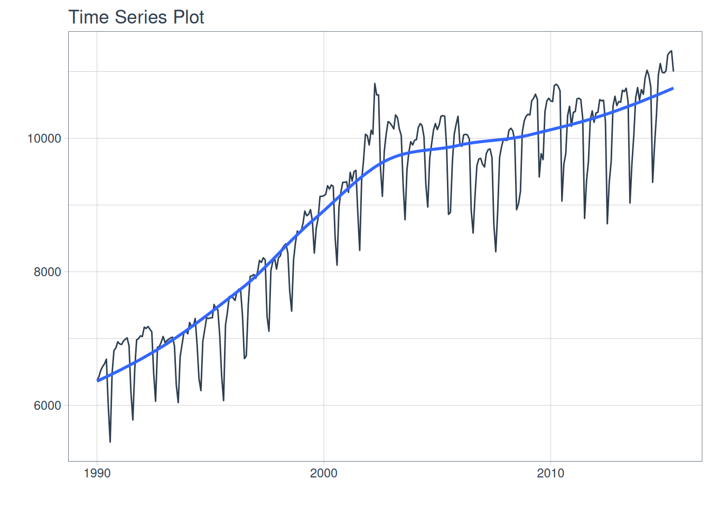
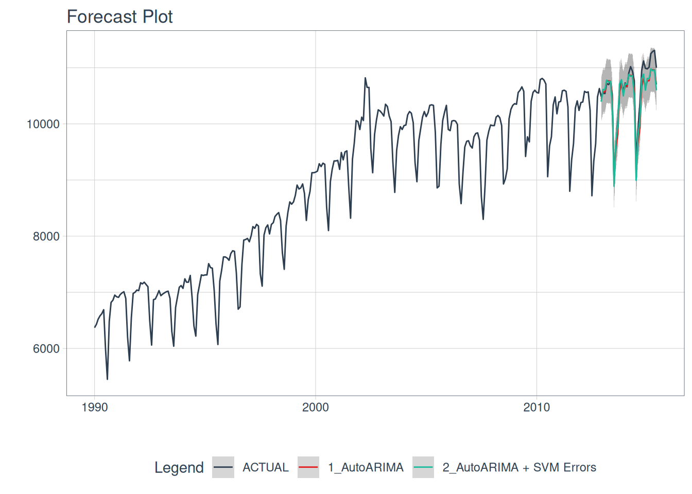
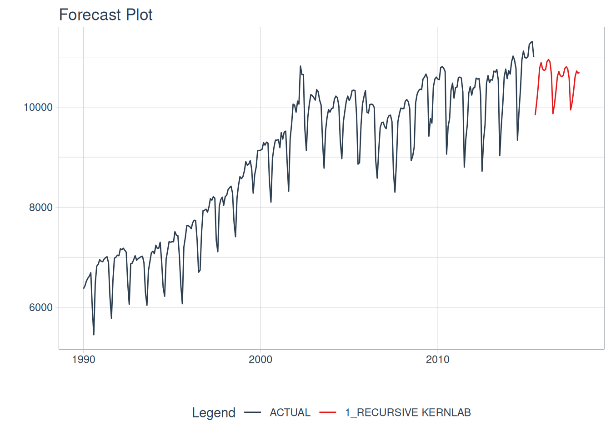

# harvestime

``` r

library(modeltime)
library(ggplot2)
library(kernlab)
#> 
#> Attaching package: 'kernlab'
#> The following object is masked from 'package:ggplot2':
#> 
#>     alpha
#> The following object is masked from 'package:modeltime':
#> 
#>     error
library(parsnip)
library(timetk)
library(maize)
#> 
#> Attaching package: 'maize'
#> The following object is masked from 'package:parsnip':
#> 
#>     check_args
#> The following object is masked from 'package:kernlab':
#> 
#>     alpha
#> The following object is masked from 'package:ggplot2':
#> 
#>     alpha
#> The following object is masked from 'package:stats':
#> 
#>     var
```

## {maize} for time series

{maize} continues into the realm of novel ML techniques. In this
release, we are looking at extending SVMs into time series. How does
this work in maize? In one of two ways: enhancing ARIMAs or via a
recursive framework.

#### ARIMA + SVM Errors

Based on the notorious **“Boosted” ARIMA** implementation in time series
machine learning. maize swaps the XGBoost algorithm with an SVM with
Laplacian Kernel.

Within this implementation, both `autoARIMA` and `ARIMA` models are both
supported, with or without external regressors. This framework leverages
two model fits! First, an ARIMA model to fit a time series regression
for the outcome variable. Next, an SVM regression is fit on the model
residuals.

*this code follows along with {modeltime}’s getting
[started](https://business-science.github.io/modeltime/articles/getting-started-with-modeltime.html).*

``` r

m750 <- m4_monthly |> dplyr::filter(id == "M750")

m750 |>
  plot_time_series(date, value, .interactive = FALSE)
#> Warning: Using `size` aesthetic for lines was deprecated in ggplot2 3.4.0.
#> ℹ Please use `linewidth` instead.
#> ℹ The deprecated feature was likely used in the timetk package.
#>   Please report the issue at
#>   <https://github.com/business-science/timetk/issues>.
#> Ignoring unknown labels:
#> • colour : "Legend"
```



Splitting our data and fitting two models, a regular AutoARIMA, and the
AutoARIMA + SVM Laplace Errors.

``` r

# Split Data 80/20
splits <- rsample::initial_time_split(m750, prop = 0.9)

# benchmark model:
model_fit_arima_no_svm <- arima_reg() |>
    set_engine(engine = "auto_arima") |>
    fit(value ~ date, data = rsample::training(splits))
#> frequency = 12 observations per 1 year

# arima SVM errors:
model_fit_arima_svm <- arima_svm_laplace(
    cost          = 10,
    margin        = .1,
    laplace_sigma = .2
     ) |>
    set_engine(engine = "auto_arima_svm_laplace") |>
    fit(value ~ date + as.numeric(date) + factor(lubridate::month(date, label = TRUE), ordered = F),
        data = rsample::training(splits))
#> frequency = 12 observations per 1 year

model_fit_arima_svm
#> parsnip model object
#> 
#> ARIMA(0,1,1)(0,1,1)[12] w/ SVM Errors
#> ---
#> Model 1: Auto ARIMA
#> Series: outcome 
#> ARIMA(0,1,1)(0,1,1)[12] 
#> 
#> Coefficients:
#>           ma1     sma1
#>       -0.3405  -0.4781
#> s.e.   0.0652   0.0628
#> 
#> sigma^2 = 25114:  log likelihood = -1699.55
#> AIC=3405.1   AICc=3405.19   BIC=3415.8
#> 
#> ---
#> Model 2: SVM Errors
#> 
#> parsnip model object
#> 
#> Support Vector Machine object of class "ksvm" 
#> 
#> SV type: eps-svr  (regression) 
#>  parameter : epsilon = 0.1  cost C = 10 
#> 
#> Laplace kernel function. 
#>  Hyperparameter : sigma =  0.2 
#> 
#> Number of Support Vectors : 244 
#> 
#> Objective Function Value : -1115 
#> Training error : 0.574759
```

parsnip minimal output:

``` r

predict(model_fit_arima_svm, rsample::testing(splits)) |> head()
#> # A tibble: 6 × 1
#>    .pred
#>    <dbl>
#> 1 10395.
#> 2 10613.
#> 3 10608.
#> 4 10779.
#> 5 10744.
#> 6 10761.
```

modeltime calibration and autoplots:

``` r

models_tbl <- modeltime_table(
    model_fit_arima_no_svm,
    model_fit_arima_svm
)

calibration_tbl <- models_tbl |>
    modeltime_calibrate(new_data = rsample::testing(splits))

calibration_tbl$.model_desc <- c("AutoARIMA", "AutoARIMA + SVM Errors")
```

##### Calibrated AutoARIMA vs. AutoARIMA w/ ‘SVM Laplacian Kernel’ Errors predictions:

``` r

calibration_tbl |>
    modeltime_forecast(
        new_data    = rsample::testing(splits),
        actual_data = m750
    ) |>
    plot_modeltime_forecast(
      .legend_max_width = 25, # For mobile screens
      .interactive      = FALSE
    )
#> Warning: Removed 306 rows containing missing values or values outside the scale range
#> (`geom_ribbon()`).
```



#### Recursive SVMs

Recursive SVMs are a bit different than the ARIMA method mentioned
above. This framework does not depend on a traditional statistical
method such as ARIMA, but revolves around lagged features of the outcome
variable as a predictor. This deviates from the `parsnip` base models
and leans towards `modeltime`. In `maize`, the goal is to have a simple
lagged interface for SVMs, not typically supported elsewhere.

This autoregressive machine learning technique can be read about more in
the {modeltime} documentation
[here](https://business-science.github.io/modeltime/articles/recursive-forecasting.html).
*Note there are many methods for lagged & rolling transformations, below
we will showcase a simple lag transformer. {maize} does not currently
have recursive() bindings but showcases how to use maize with
modeltime’s recursive() below!*

``` r

 # splits 
splits   <- rsample::initial_time_split(m750, prop = 0.9)
training <- rsample::training(splits) 
testing  <- rsample::testing(splits)  

# horizon and number of lags:
horizon <- nrow(testing)

lag_transformer <- function(data){
  data |>
    timetk::tk_augment_lags(value, .lags = 1:horizon)
}
```

``` r


extended <- m750 |>
  dplyr::group_by(id) |>
  timetk::future_frame(
    .length_out = horizon,
    .bind_data  = TRUE
  )
#> .date_var is missing. Using: date

m4_lags <- extended |>
  lag_transformer()

train_data <- m4_lags |>
  tidyr::drop_na()

future_data <- m4_lags |>
  dplyr::filter(is.na(value))

model_fit_recursive_svm_laplace <- svm_laplace(
  mode = "regression",
  cost = 10,
  margin = .1,
  laplace_sigma = .2
) |>
  set_engine("kernlab") |>
  fit(
    value ~ .
    + lubridate::month(date, label = TRUE)
    + as.numeric(date)
    - date,
    data = train_data
  ) |>
  modeltime::recursive(
    transform  = lag_transformer,
    train_tail = tail(train_data, horizon)
  )
  
model_tbl <- modeltime_table(
  model_fit_recursive_svm_laplace
)


model_tbl |>

  # Forecast using future data
  modeltime_forecast(
    new_data    = future_data,
    actual_data = m750
  ) |>

  # Visualize the forecast
  plot_modeltime_forecast(
    .interactive        = FALSE,
    .conf_interval_show = FALSE
  )
#> Adding missing grouping variables: `id`
```


