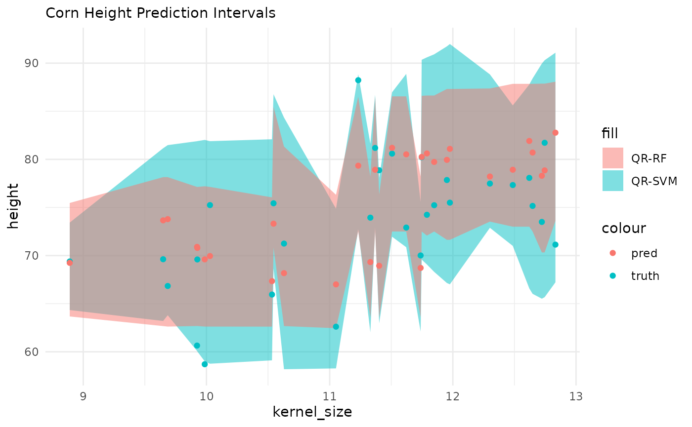

# perchance

### Post-Processing in {maize}???

**based entirely on the {probably} package implementation for conformal
inference & calibration. Hence the pun perchance?**

The {probably} package implements the int_conformal_quantile method for
generating prediction intervals. This method utilizes random forest
quantile regression as its underlying algorithm. In the {maize} package,
a new method called int_conformal_quantile_svm has been introduced. This
implementation replaces the original quantile regression random forest
{quantregForest} approach with a quantile regression SVM {qrsvm}. It’s
worth noting that the int_conformal_quantile_svm method relies on the
{qrsvm} package, which is currently not available on CRAN.

#### Key Components

{probably} Package  
Method: int_conformal_quantile  
Algorithm:
[`quantregForest::quantregForest()`](https://rdrr.io/pkg/quantregForest/man/quantregForest.html)

{maize} Package  
Method: int_conformal_quantile_svm  
Algorithm: [`qrsvm::qrsvm()`](https://rdrr.io/pkg/qrsvm/man/qrsvm.html)

#### Implementation Details

The int_conformal_quantile_svm method in {maize} represents a
straightforward substitution of the RF algorithm. Instead of using
random forests, it employs SVMs for generating prediction intervals.
This modification allows users to leverage the potential benefits of
SVMs in certain prediction scenarios.

#### Dependency Note

The {qrsvm} package, which is required for the SVM-based implementation
in {maize}, is not currently hosted on CRAN. Users interested in
utilizing the int_conformal_quantile_svm method should be aware of this
external dependency and may need to install it from
github.com/frankiethull/qrsvm.

``` r

library(qrsvm)
library(dplyr)
library(parsnip)
library(maize)
library(recipes)
library(workflows)
library(kernlab)
library(probably)
```

### point and interval regressions

The following demonstration begins with an initial point forecast using
a Support Vector Machine (SVM) with a Laplacian kernel. Subsequently, we
utilize our out-of-bag (OOB) sample to construct conformal prediction
intervals. In this comparison, we will evaluate both the
int_conformal_quantile method from the {probably} package and the
int_conformal_quantile_svm method from the {maize} package. This
analysis will provide insights into the performance and characteristics
of these two approaches for generating prediction intervals.

``` r


set.seed(31415)

  # note: qrsvm does not work for non-numeric values
corn_df <- corn_data |> mutate(type = as.numeric(factor(type, levels = levels(type))))

corn_train <- corn_df |> dplyr::sample_frac(.80)
corn_cal   <- corn_df |> dplyr::anti_join(corn_train) |> head(30)
corn_test  <- corn_df |> dplyr::anti_join(corn_train) |> tail(30)


# SVM base model 
svm_spec <-
  svm_laplace() |>
  set_mode("regression")

svm_wflow <-
  workflow() |>
  add_model(svm_spec) |>
  add_formula(height ~ .)

svm_fit <- fit(svm_wflow, data = corn_train)


# probably's implementation:
rf_int <- probably::int_conformal_quantile(svm_fit, corn_train, corn_cal,
  level = 0.80
)

# experimental QRSVM interface for CQR: 
svm_int <- int_conformal_quantile_svm(svm_fit, corn_train, corn_cal,
  level = 0.80, cost = 1000, degree = 5
)

svm_int
#> Split Conformal inference via Quantile Regression SVM
#> preprocessor: formula 
#> model: svm_laplace (engine = kernlab) 
#> calibration set size: 30 
#> confidence level: 0.8 
#> 
#> Use `predict(object, new_data)` to compute prediction intervals
```

### predict with intervals

``` r

cqr_rf  <- predict(rf_int,  corn_test)
cqr_svm <- predict(svm_int, corn_test)


# renaming pre-plotting
names(cqr_rf)  <- c(".pred", ".pred_lo_rf",  ".pred_hi_rf")
names(cqr_svm) <- c(".pred", ".pred_lo_svm", ".pred_hi_svm")
```

### check conformal quantile prediction intervals

## SVM with QRF & QRSVM Prediction Intervals

``` r

library(ggplot2)
#> 
#> Attaching package: 'ggplot2'
#> The following object is masked from 'package:kernlab':
#> 
#>     alpha
#> The following object is masked from 'package:maize':
#> 
#>     alpha

corn_test |>
  dplyr::bind_cols(cqr_svm) |>
  dplyr::bind_cols(cqr_rf |> dplyr::select(-.pred)) |>
  ggplot() +
  geom_ribbon(aes(x = kernel_size, ymin = .pred_lo_svm, ymax = .pred_hi_svm, fill = "QR-SVM"), alpha = .5) +
  geom_ribbon(aes(x = kernel_size, ymin = .pred_lo_rf,  ymax = .pred_hi_rf,  fill = "QR-RF"),  alpha = .5) +
  geom_point(aes(x = kernel_size, y = height, color = "truth")) +
  geom_point(aes(x = kernel_size, y = .pred,  color = "pred")) + 
  theme_minimal() +
  labs(subtitle = "Corn Height Prediction Intervals")
```



## SVM with Linear & SVM Calibration

In addition to conformal prediction intervals, the {maize} package
offers a post-process calibration engine that is similar to the one in
{probably}, but utilizes Support Vector Machines (SVMs). The {probably}
package includes the cal_estimate_linear function, which calibrates
point forecasts using a post-model to address bias in the initial fit.
{maize} provides a comparable function called cal_estimate_svm. This
function follows a similar framework to cal_estimate_linear, but employs
either a vanilla or polynomial kernel, depending on the user’s selection
in the “smooth” argument. The following section demonstrates the
application of this calibration approach.

#### Key Components

{probably} Package  
Method: cal_estimate_linear  
Algorithms:  
- [`stats::glm()`](https://rdrr.io/r/stats/glm.html) is used when smooth
is set to `FALSE`  
- [`mgcv::gam()`](https://rdrr.io/pkg/mgcv/man/gam.html) is used when
smooth is set to `TRUE`

{maize} Package  
Method: cal_estimate_svm  
Algorithms:  
- `kernlab::ksvm(kernel = "vanilladot")` is used when smooth is set to
`FALSE`  
- `kernlab::ksvm(kernel = "polydot")` is used when smooth is set to
`TRUE`

#### Implementation Details

The cal_estimate_svm method in {maize} represents a straightforward
substitution of the linear calibration. Instead of using linear models,
it employs SVMs for post-calibration. This modification allows users to
leverage the potential benefits of SVMs in certain prediction scenarios.

``` r

calibration_df <-  predict(svm_fit, corn_cal) |> dplyr::bind_cols(corn_cal)


# probably's implementation:
lin_cal_fit <- calibration_df |> 
            probably::cal_estimate_linear(truth = height, estimate = .pred, smooth = TRUE)
#> Registered S3 method overwritten by 'butcher':
#>   method                 from    
#>   as.character.dev_topic generics

# experimental svm calibration (vanilladot or polydot)
svm_cal_fit <- calibration_df |>
            maize::cal_estimate_svm(height, smooth = TRUE)
#>  Setting default kernel parameters

# preds
cal_corn_test <- 
predict(svm_fit, corn_test) |>
  cbind(corn_test)
  
# calibrated preds:
maize::cal_apply_regression(svm_cal_fit, cal_corn_test) |> head(10)
#>       .pred   height kernel_size type
#> 1  64.42768 62.61279   11.051488    2
#> 2  65.53022 71.24822   10.629400    2
#> 3  66.25433 78.86852   11.401994    2
#> 4  68.00431 69.60042    9.926075    2
#> 5  66.04308 70.01313   11.738339    2
#> 6  70.82399 66.84150    9.685755    2
#> 7  70.70666 69.62163    9.648538    2
#> 8  67.20650 75.24819   10.028623    2
#> 9  66.54068 69.38940    8.890259    2
#> 10 68.10534 60.64923    9.923742    2
```
